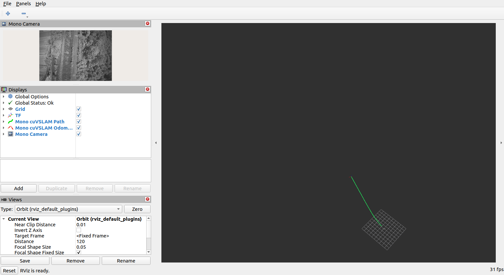

# 階段 4：TF、RViz2、rosbag 與追蹤量測

使用階段 3 的單目 PyCuVSLAM Node 與現有圖片；不需要實體相機，也沒有使用 Isaac ROS cuVSLAM Node。單目位移沒有絕對尺度，`cuvslam_odom_optical` 是起始相機的光學座標方向，不應把平移數值當作公尺送往 PX4。

## 建置與啟動

```bash
cd /home/user/mono-cuvslam-ros2/ros2_ws
source /opt/ros/humble/setup.bash
colcon build --symlink-install --packages-select mono_camera_driver mono_cuvslam
cd /home/user/mono-cuvslam-ros2
source scripts/ros_env.sh
ros2 launch mono_cuvslam stage4_offline.launch.py \
  max_frames:=300 use_rviz:=false metrics_output:=/tmp/mono-stage4-300.json
```

Launch 預設讀 `/home/user/2026-06-22VTOL/firefly`，從第二張 `firefly_006800.png` 開始，使用 [假設內參](../config/firefly_20260622_assumed.yaml)。`source_fps:=30.0` 只供資料缺少時間戳時合成逐張時間戳；`replay_fps:=0.0` 表示無播放速度上限，會在 cuVSLAM 確認上一張處理完畢後立即送下一張。圖片發布器同時在背景預先解碼下一張，減少等待時間。可調整 `image_dir`、`calibration_file`、`start_index`、`max_frames`、`source_fps`、`replay_fps`。`max_frames:=0` 代表播放從起點到資料夾結尾，量測 Node 會持續統計直到按 Ctrl+C。

量測 Node 在收到指定張數後列印 `STAGE4_METRICS`，並在 `metrics_output` 指定路徑寫入 JSON。Launch 仍會保持執行，以供查看 RViz；結束時按 Ctrl+C。報告的 `processing_fps` 使用首末處理確認的實際經過時間，包含圖片解碼、ROS 傳送與 cuVSLAM 計算，不是相機原始拍攝 FPS。`tracking_ratio`、`max_tracking_streak` 用於觀察連續性；`tf_odometry_matches`、最大姿態差用於檢查 TF 是否和 Odometry 一致。

## 完整資料軌跡圖

完整資料測試可將每筆有效 Odometry 寫入 CSV，再畫 XY 與 Z 圖：

```bash
cd /home/user/mono-cuvslam-ros2
source scripts/ros_env.sh
ros2 launch mono_cuvslam stage4_offline.launch.py \
  max_frames:=10966 use_rviz:=false path_history_poses:=100 \
  metrics_output:=/home/user/mono-cuvslam-ros2/results/full_firefly_20260622/metrics.json \
  trajectory_output:=/home/user/mono-cuvslam-ros2/results/full_firefly_20260622/trajectory.csv
/usr/bin/python3 scripts/plot_trajectory.py \
  results/full_firefly_20260622/trajectory.csv
```

`max_frames:=10966` 對應目前 10,967 張符合檔名的 PNG，從 `start_index:=1` 略過第一張。量測 Node 完成後會寫 JSON，launch 仍需按 Ctrl+C 結束。CSV 包含全部有效姿態；`path_history_poses` 只控制 ROS `/path` 即時訊息長度。繪圖會在時間戳缺口處斷線，避免把追蹤中斷前後的位姿接起來。`trajectory_xy.png` 是光學座標的 X/Y 平面圖，`trajectory_z.png` 是光學 Z 隨影格變化圖；光學 Z 指向鏡頭前方，不是真實高程。單目平移尺度未知。

## 跑完後產生同步影片

`scripts/render_trajectory_video.py` 讀取原始圖片、逐筆姿態 CSV 和量測 JSON，產生 MP4：左側為目前影像，右側逐漸畫出 XY 軌跡與 Z 曲線，下方列出目前 X/Y/Z、Roll/Pitch/Yaw、四元數與是否有有效姿態。沒有新姿態的影格仍顯示影像和上一筆姿態，並標示 `NO POSE`。角度以 cuVSLAM 光學 odometry 座標系的 XYZ/Roll-Pitch-Yaw 表示；單目平移尺度未知，Z 指向鏡頭前方。

新版本量測 JSON 會記錄 `first_ack_stamp_ns`，因此可從來源 30 FPS 合成時間戳精確對上每張圖片。舊版 JSON 沒有該欄位，須由測試紀錄提供第一筆有效姿態的零起算影格索引；此值若不正確，影片就會錯位。下例舊測試的第 9 張是根據啟動日誌與重跑短序列推定，仍不如新版本的時間戳直接紀錄可靠。範例：

```bash
cd /home/user/mono-cuvslam-ros2
/usr/bin/python3 scripts/render_trajectory_video.py \
  --image-dir /home/user/2026-06-22VTOL/firefly \
  --start-image firefly_008011.png \
  --trajectory-csv results/from_008011/trajectory.csv \
  --metrics-json results/from_008011/metrics.json \
  --output results/from_008011/camera_trajectory.mp4 \
  --first-pose-frame 9
```

預設影片速度為 30 FPS，可用 `--video-fps` 調整；`--limit 30` 可先製作短預覽。這是跑完後的影片製作，不會重新執行 cuVSLAM。

## RViz2

RViz2 啟動時載入 [stage4.rviz](../ros2_ws/src/mono_cuvslam/rviz/stage4.rviz)，固定座標系為 `cuvslam_odom_optical`，顯示 Image、Path、Odometry 與 TF。將上面的 launch 參數改成 `use_rviz:=true` 即可開啟。Odometry 的協方差圖形在預設 RViz 設定下會遮住軌跡，因此此設定只顯示最新相機姿態軸，不畫協方差球體。

若本機沒有 RViz2，可在 Jetson 終端執行：

```bash
sudo apt-get install -y ros-humble-rviz2
```

TF 僅在 `TRACKING` 時發布，動態轉換為 `cuvslam_odom_optical` → `camera_optical_frame`；與同時間戳 Odometry 的位姿相同。沒有 `/map` 或相機機身的額外靜態 TF。

在 Jetson 桌面以 100 張現有圖片執行 `use_rviz:=true`，已確認相機影像、綠色軌跡、TF 和 Odometry 顯示正常，RViz 整體狀態為 `Ok`。畫面紀錄：



## rosbag 錄製與回放

先開終端 A 錄製，再開終端 B 執行上述 launch：

```bash
source /home/user/mono-cuvslam-ros2/scripts/ros_env.sh
ros2 bag record -o /tmp/mono-stage4-bag --storage sqlite3 \
  /camera/image_raw /camera/camera_info \
  /mono_cuvslam/odometry /mono_cuvslam/path \
  /mono_cuvslam/tracking_status /mono_cuvslam/processed_stamp_ns /tf
```

播放結束後在終端 A 按 Ctrl+C，使 rosbag 寫出 metadata；再檢查與回放：

```bash
ros2 bag info /tmp/mono-stage4-bag
ros2 bag play /tmp/mono-stage4-bag --delay 2
```

錄製目錄必須尚未存在；重跑請換新的 `-o` 路徑。回放時停止原始圖片序列與追蹤 Node，以免同名 topic 混在一起。若要在回放時重新計算追蹤，應只錄／播 `/camera/image_raw` 和 `/camera/camera_info`，並另外啟動 `mono_cuvslam_node --ros-args -p input_reliability:=reliable`；不要同時回放先前錄下的 Odometry 和 TF。

## Jetson 實測

| 測試 | 結果 |
| --- | --- |
| 300 張、無播放 FPS 上限 | 300 張全數確認，`TRACKING` 290 張，暖機 10 張，未出現 `LOST` |
| 處理速度，不開 RViz | 首末處理確認相隔 9.914 秒，平均 30.159 張／秒 |
| 處理速度，開啟 RViz | 首末處理確認相隔 10.520 秒，平均 28.423 張／秒 |
| TF 與 Odometry | 各 290 筆；290 筆時間戳與姿態逐筆相符，位置及旋轉最大差皆為 0 |
| 30 張 rosbag | 影像／內參／處理確認／追蹤狀態各 30 筆，TF／Odometry／Path 各 20 筆，約 44.6 MiB |
| rosbag 回放 | 量測 Node 重新收到相同筆數及 TF／Odometry 對應關係 |
| RViz2 畫面 | 在 Jetson OpenGL 4.6 桌面啟動成功；100 張測試中 90 張 `TRACKING`，影像、Path、Odometry 和 TF 顯示正常 |

這些數值只驗證此圖片序列上的運作與追蹤連續性；內參主點方向及真實逐張拍攝時間戳仍未確認，不能據此判定軌跡的定量精度。實體相機驅動的驗收仍待接上相機後補做。

## GPU 與效能診斷

cuVSLAM 的 Mono 設定明確使用 `use_gpu=True`，`cuvslam.warm_up_gpu()` 在 Jetson CUDA 上成功；測試期間 `tegrastats` 也觀察到 GPU 活動。GPU 使用率是全機數值，不能單憑它判定每一個運算都在 GPU 上。可重跑直接測速：

```bash
cd /home/user/mono-cuvslam-ros2
source scripts/ros_env.sh
/usr/bin/python3 scripts/benchmark_cuvslam_core.py --frames 100
```

相同 100 張的直接測試中，PNG 解碼平均 24.410 ms、cuVSLAM `track()` 平均 8.865 ms，解碼加追蹤整體約 30.004 張／秒。舊 ROS 發布器直接把 1440×1080 影像的 `bytes` 指派給 `Image.data`，ROS 2 Python 會逐像素驗證，單次約 351 ms；改用 `array('B')` 後，單次約 0.3 ms。再加入一張影像的背景預先解碼後，正式跨程序流程由原先 2.852 提升至 30.159 張／秒。以上是此 Jetson 與這組資料的實測值，`source_fps:=30.0` 並未限制播放速度。
